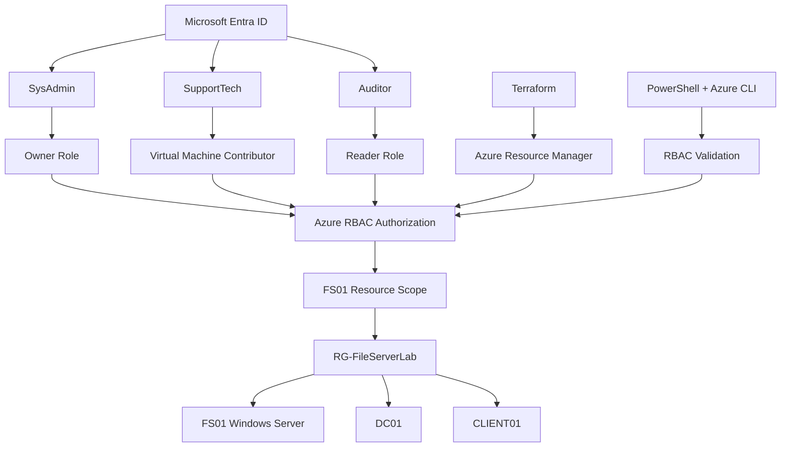
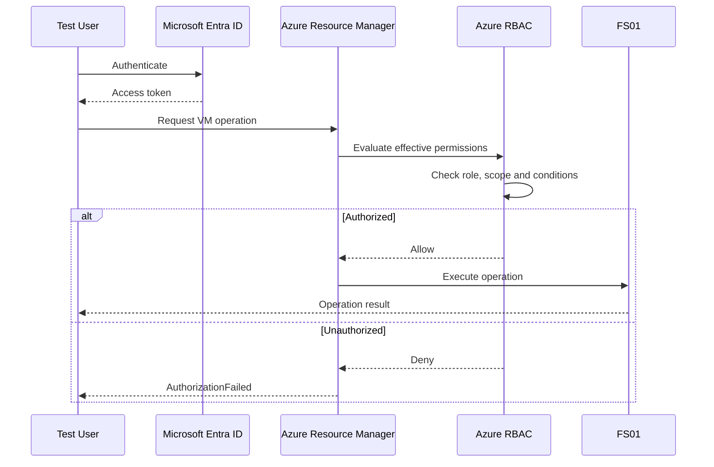

# Enterprise Azure RBAC Access Control

### Microsoft Azure | Microsoft Entra ID | Azure RBAC | Terraform | PowerShell | Least Privilege

**Project Status:** Implementation and validation pending

---

## 1. Executive Summary

This project demonstrates the implementation of **Azure Role-Based Access Control (RBAC)** to secure cloud infrastructure through identity-based authorization, resource-level role assignments, and least-privilege access.

The lab builds on the existing Microsoft Azure infrastructure deployed in **Lab 1 — NTFS File Server Lab**.

Rather than provisioning additional virtual machines, this project configures three Azure RBAC role assignments on the existing **FS01 Windows Server virtual machine**.

Three administrative personas are used:

- **SysAdmin:** Owner
- **SupportTech:** Virtual Machine Contributor
- **Auditor:** Reader

The goal is to ensure that each identity receives only the permissions required to perform its assigned responsibilities.

The lab demonstrates practical skills in:

- Identity and Access Management (IAM)
- Microsoft Entra ID
- Azure Role-Based Access Control
- Privileged Access Management
- Least-Privilege Security
- Cloud Infrastructure Authorization
- Terraform Infrastructure as Code
- PowerShell Automation
- Access Control Validation
- Security Auditing

> **Implementation status:** This README documents the planned configuration and expected results. Deployment, validation, and security testing must be completed before claiming successful implementation.

---

## 2. Table of Contents

1. [Executive Summary](#1-executive-summary)
2. [Table of Contents](#2-table-of-contents)
3. [Business Problem](#3-business-problem)
4. [Project Objectives](#4-project-objectives)
5. [Lab Environment](#5-lab-environment)
6. [Architecture Diagram](#6-architecture-diagram)
7. [Azure RBAC Design](#7-azure-rbac-design)
8. [Lab Dependencies](#8-lab-dependencies)
9. [Prerequisites](#9-prerequisites)
10. [Step 1 — Create Project Folder](#10-step-1--create-project-folder)
11. [Step 2 — Create Terraform Files](#11-step-2--create-terraform-files)
12. [Step 3 — Create PowerShell Scripts](#12-step-3--create-powershell-scripts)
13. [Step 4 — Prepare Test Users](#13-step-4--prepare-test-users)
14. [Step 5 — Configure Terraform Variables](#14-step-5--configure-terraform-variables)
15. [Step 6 — Deploy and Validate RBAC](#15-step-6--deploy-and-validate-rbac)
16. [Step 7 — Test Each Persona](#16-step-7--test-each-persona)
17. [Security Validation](#17-security-validation)
18. [Troubleshooting](#18-troubleshooting)
19. [Teardown and Cleanup](#19-teardown-and-cleanup)
20. [Project Deliverables](#20-project-deliverables)
21. [Skills Demonstrated](#21-skills-demonstrated)
22. [References](#22-references)

---

## 3. Business Problem

Organizations operating cloud infrastructure must control who can manage resources and what actions those users are authorized to perform.

Without properly configured RBAC, employees may receive excessive permissions that allow them to:

- Delete critical virtual machines.
- Modify infrastructure configurations.
- Assign privileged roles.
- Access resources outside their responsibilities.
- Disrupt production services.
- Introduce security and compliance risks.

### Business Scenario

An organization operates a Windows file server named **FS01** in Microsoft Azure.

Three employees require different levels of administrative access.

**SysAdmin**

The senior system administrator manages the file server and its Azure access assignments.

**SupportTech**

A help desk technician is responsible for supporting the availability of the file server, including starting and restarting the virtual machine.

**Auditor**

A compliance auditor must review resource configuration and access assignments without modifying the virtual machine.

### Proposed Solution

Implement Azure RBAC with role assignments scoped specifically to the FS01 resource.

The implementation will:

1. Identify three Microsoft Entra ID test users.
2. Retrieve their Entra object IDs.
3. Assign predefined Azure RBAC roles.
4. Restrict the assignment scope to FS01.
5. Deploy the configuration through Terraform.
6. Validate the role assignments using PowerShell.
7. Test allowed and denied operations.
8. Export a structured access validation report.

---

## 4. Project Objectives

The project objectives are to:

1. Understand Azure RBAC authorization.
2. Differentiate Azure RBAC from NTFS permissions.
3. Implement resource-level access control.
4. Apply the principle of least privilege.
5. Retrieve Microsoft Entra ID object identifiers.
6. Reference existing Azure infrastructure through Terraform data sources.
7. Create three Azure role assignments.
8. Configure Owner permissions.
9. Configure Virtual Machine Contributor permissions.
10. Configure Reader permissions.
11. Validate assignments using Azure CLI.
12. Test authorization with separate identities.
13. Identify excessive permissions.
14. Export RBAC validation evidence.
15. Maintain independent Terraform state.
16. Remove lab assignments without destroying Lab 1.

---

## 5. Lab Environment

| Component | Configuration |
|-----------|---------------|
| Cloud Platform | Microsoft Azure |
| Identity Provider | Microsoft Entra ID |
| Authorization | Azure RBAC |
| Existing Resource Group | RG-FileServerLab |
| Target Virtual Machine | FS01 |
| Existing Domain | lab.local |
| Infrastructure Provisioning | Terraform |
| Automation | PowerShell |
| Resource Management | Azure CLI |
| Remote State | Azure Blob Storage |
| Terraform State Key | rbac-lab.terraform.tfstate |
| Role Assignments | 3 |
| New Virtual Machines | 0 |
| New Networking Resources | 0 |

### Existing Infrastructure

Lab 1 must already contain:

| Resource | Role |
|----------|------|
| DC01 | Active Directory Domain Controller |
| FS01 | Windows File Server |
| CLIENT01 | Windows Client Workstation |
| RG-FileServerLab | Azure Resource Group |
| Azure VNet | Private network |
| Azure Key Vault | Secrets management |

### Estimated Deployment

The three role assignments may deploy in approximately one minute, excluding Terraform initialization and Azure RBAC propagation.

Role assignments themselves do not incur a separate Azure charge. Existing Lab 1 resources may continue generating charges.

---

## 6. Architecture Diagram

### Azure RBAC Architecture



### Resource Scope

All three role assignments target the FS01 virtual machine resource ID.

```text
Azure Subscription
│
└── RG-FileServerLab
    │
    ├── DC01
    │   └── No new assignments from Lab 2
    │
    ├── FS01
    │   ├── SysAdmin → Owner
    │   ├── SupportTech → Virtual Machine Contributor
    │   └── Auditor → Reader
    │
    └── CLIENT01
        └── No new assignments from Lab 2
```

### Azure RBAC Authorization Flow



### Azure RBAC vs NTFS Permissions

| Security Control | Azure RBAC | NTFS |
|------------------|------------|------|
| Enforcement Layer | Azure control plane | Windows file system |
| Scope | Azure resources | Files and folders |
| Identity Source | Microsoft Entra ID principals | Windows security principals |
| Example | Start or stop FS01 | Read Finance files |
| Configuration | Azure role assignments | File system ACLs |
| Lab | Lab 2 | Lab 1 |

**Important:** Azure RBAC does not replace NTFS permissions.

Both security layers must be configured independently.

---

## 7. Azure RBAC Design

### Administrative Personas

| Persona | Azure Role | Scope |
|---------|------------|-------|
| SysAdmin | Owner | FS01 |
| SupportTech | Virtual Machine Contributor | FS01 |
| Auditor | Reader | FS01 |

### Role Responsibilities

#### SysAdmin — Owner

The Owner role grants broad management permissions over the scoped resource, including the ability to manage Azure RBAC role assignments.

Use this role only for the designated privileged lab identity.

#### SupportTech — Virtual Machine Contributor

The Virtual Machine Contributor role supports management of virtual machines, including operations such as starting, stopping, restarting, and deleting VMs.

**Security consideration:** This built-in role is broader than a restart-only help desk role. It is used here to demonstrate Azure RBAC, but it is not appropriate if the business requirement is to prevent VM deletion or configuration changes.

For strict least privilege, create a custom role containing only the required VM operations.

#### Auditor — Reader

The Reader role provides read-only access to Azure resource configuration and status.

It does not grant VM management permissions.

### Expected Permission Matrix

| Action | Owner | VM Contributor | Reader |
|--------|-------|----------------|--------|
| View FS01 details | Yes | Yes | Yes |
| Start FS01 | Yes | Yes | No |
| Stop FS01 | Yes | Yes | No |
| Restart FS01 | Yes | Yes | No |
| Delete FS01 | Yes | Yes | No |
| Modify VM configuration | Yes | Yes | No |
| Manage Azure RBAC assignments | Yes | No | No |

> Effective permissions may also come from other assignments at the management group, subscription, or resource group scope. Test accounts should not have additional roles that invalidate the lab's expected results.

### Role Assignment Scope

Correct:

```hcl
scope = data.azurerm_virtual_machine.fs01.id
```

Incorrect for this lab:

```hcl
scope = data.azurerm_resource_group.lab.id
```

The second configuration would grant access across the resource group rather than restricting the assignment to FS01.

---

## 8. Lab Dependencies

This lab depends on Lab 1.

### Lab Relationship

| Lab | Resources | Dependency |
|-----|-----------|------------|
| Lab 1 — NTFS File Server | DC01, FS01, CLIENT01, networking, Key Vault | Standalone |
| Lab 2 — Azure RBAC | Three FS01 role assignments | Depends on Lab 1 |
| Azure Update Manager Lab | Independent VMs and infrastructure | Standalone |

### Terraform State Separation

Lab 1:

```text
ntfs-lab.terraform.tfstate
```

Lab 2:

```text
rbac-lab.terraform.tfstate
```

Both state files reside in the same Azure Blob Storage container.

This separation allows Lab 2 to manage its own role assignments without managing or recreating Lab 1 infrastructure.

---

## 9. Prerequisites

### Required Tools

- Terraform 1.5 or later
- Azure CLI
- PowerShell
- Visual Studio Code
- Azure subscription
- Microsoft Entra ID tenant

### Required Permissions

The deploying identity must have permission to create Azure role assignments at the target scope.

An appropriate privileged role, such as Role Based Access Control Administrator or User Access Administrator, may be required.

### Step 9.1 — Verify Terraform

```powershell
terraform -version
```

### Step 9.2 — Verify Azure CLI

```powershell
az version
```

### Step 9.3 — Authenticate

```powershell
az login
```

### Step 9.4 — Verify Subscription

```powershell
az account show
```

If needed:

```powershell
az account set --subscription "<SUBSCRIPTION_ID>"
```

### Step 9.5 — Verify Existing Resource Group

```powershell
az group show `
    --name RG-FileServerLab `
    --output table
```

### Step 9.6 — Verify FS01 Exists

```powershell
az vm show `
    --resource-group RG-FileServerLab `
    --name FS01 `
    --query "{name:name,id:id,location:location}" `
    --output json
```

### Step 9.7 — Check VM Power States

```powershell
az vm list `
    --resource-group RG-FileServerLab `
    --show-details `
    --query "[].{Name:name,PowerState:powerState}" `
    --output table
```

> Azure RBAC assignments can be created while the VM is deallocated. Start FS01 when performing start/stop and other live operational tests.

### Screenshot Evidence

- `RBAC-01` — Terraform version
- `RBAC-02` — Azure CLI version
- `RBAC-03` — Azure subscription
- `RBAC-04` — Existing resource group
- `RBAC-05` — FS01 VM verification

---

## 10. Step 1 — Create Project Folder

Lab 2 must use a separate Terraform project folder.

### Step 1.1 — Create Directory

```powershell
New-Item `
    -ItemType Directory `
    -Path "$HOME\rbac-lab-terraform" `
    -Force
```

### Step 1.2 — Navigate to Directory

```powershell
Set-Location "$HOME\rbac-lab-terraform"
```

### Step 1.3 — Create Scripts Directory

```powershell
New-Item `
    -ItemType Directory `
    -Path ".\scripts" `
    -Force
```

### Step 1.4 — Open VS Code

```powershell
code .
```

### Project Structure

```text
rbac-lab-terraform/
│
├── backend.tf
├── versions.tf
├── variables.tf
├── data.tf
├── rbac.tf
├── outputs.tf
├── terraform.tfvars.example
├── terraform.tfvars
├── .gitignore
├── validate-lab.ps1
│
└── scripts/
    └── 01-get-object-ids.ps1
```

### Validation

```powershell
Get-ChildItem -Recurse
```

### Screenshot Evidence

- `RBAC-06` — Project folder in VS Code
- `RBAC-07` — Terraform file structure
- `RBAC-08` — PowerShell scripts folder

---

## 11. Step 2 — Create Terraform Files

### File 1 — backend.tf

This file configures Terraform remote state.

It reuses the Azure Storage account from Lab 1.

Replace the placeholder with the actual storage account name.

```hcl
terraform {
  backend "azurerm" {
    resource_group_name  = "RG-TerraformState"
    storage_account_name = "REPLACE_WITH_YOUR_LAB1_STORAGE_ACCOUNT_NAME"
    container_name       = "tfstate"
    key                  = "rbac-lab.terraform.tfstate"
  }
}
```

**Important:** The state key must differ from Lab 1.

### File 2 — versions.tf

```hcl
terraform {
  required_version = ">= 1.5.0"

  required_providers {
    azurerm = {
      source  = "hashicorp/azurerm"
      version = "~> 3.0"
    }
  }
}

provider "azurerm" {
  features {}
}
```

> This preserves the AzureRM 3.x provider family from the supplied lab. Review provider compatibility before deployment.

### File 3 — variables.tf

```hcl
variable "resource_group_name" {
  description = "Existing resource group from Lab 1."
  type        = string
  default     = "RG-FileServerLab"
}

variable "vm_name" {
  description = "Existing VM from Lab 1."
  type        = string
  default     = "FS01"
}

variable "location" {
  description = "Azure region."
  type        = string
  default     = "Central US"
}

variable "sysadmin_object_id" {
  description = "Entra object ID for SysAdmin."
  type        = string
}

variable "support_user_object_id" {
  description = "Entra object ID for SupportTech."
  type        = string
}

variable "auditor_object_id" {
  description = "Entra object ID for Auditor."
  type        = string
}
```

The three object ID variables intentionally have no defaults.

This prevents Terraform from silently assigning roles to placeholder identities.

### File 4 — data.tf

Terraform data sources reference existing Lab 1 resources.

```hcl
data "azurerm_resource_group" "lab" {
  name = var.resource_group_name
}

data "azurerm_virtual_machine" "fs01" {
  name                = var.vm_name
  resource_group_name = data.azurerm_resource_group.lab.name
}
```

These data sources read existing resources rather than creating new ones.

### File 5 — rbac.tf

This file defines the three Azure RBAC role assignments.

#### SysAdmin — Owner

```hcl
resource "azurerm_role_assignment" "sysadmin_owner" {
  scope                = data.azurerm_virtual_machine.fs01.id
  role_definition_name = "Owner"
  principal_id         = var.sysadmin_object_id
}
```

#### SupportTech — Virtual Machine Contributor

```hcl
resource "azurerm_role_assignment" "supporttech_vm_contributor" {
  scope                = data.azurerm_virtual_machine.fs01.id
  role_definition_name = "Virtual Machine Contributor"
  principal_id         = var.support_user_object_id
}
```

#### Auditor — Reader

```hcl
resource "azurerm_role_assignment" "auditor_reader" {
  scope                = data.azurerm_virtual_machine.fs01.id
  role_definition_name = "Reader"
  principal_id         = var.auditor_object_id
}
```

### Complete rbac.tf

Place all three resources together in the same file:

```hcl
# SysAdmin — Owner

resource "azurerm_role_assignment" "sysadmin_owner" {
  scope                = data.azurerm_virtual_machine.fs01.id
  role_definition_name = "Owner"
  principal_id         = var.sysadmin_object_id
}

# SupportTech — Virtual Machine Contributor

resource "azurerm_role_assignment" "supporttech_vm_contributor" {
  scope                = data.azurerm_virtual_machine.fs01.id
  role_definition_name = "Virtual Machine Contributor"
  principal_id         = var.support_user_object_id
}

# Auditor — Reader

resource "azurerm_role_assignment" "auditor_reader" {
  scope                = data.azurerm_virtual_machine.fs01.id
  role_definition_name = "Reader"
  principal_id         = var.auditor_object_id
}
```

### File 6 — outputs.tf

```hcl
output "resource_group_name" {
  value = data.azurerm_resource_group.lab.name
}

output "vm_name" {
  value = data.azurerm_virtual_machine.fs01.name
}

output "vm_id" {
  description = "FS01 Azure resource ID."
  value       = data.azurerm_virtual_machine.fs01.id
}

output "rbac_summary" {
  description = "Azure RBAC role assignment IDs."
  sensitive   = true

  value = {
    owner       = azurerm_role_assignment.sysadmin_owner.id
    contributor = azurerm_role_assignment.supporttech_vm_contributor.id
    reader      = azurerm_role_assignment.auditor_reader.id
  }
}
```

### File 7 — terraform.tfvars.example

```hcl
resource_group_name = "RG-FileServerLab"
vm_name             = "FS01"
location            = "Central US"

sysadmin_object_id     = "REPLACE_WITH_SYSADMIN_OBJECT_ID"
support_user_object_id = "REPLACE_WITH_SUPPORTTECH_OBJECT_ID"
auditor_object_id      = "REPLACE_WITH_AUDITOR_OBJECT_ID"
```

### File 8 — .gitignore

```gitignore
terraform.tfvars
*.tfvars
!terraform.tfvars.example

terraform.tfstate
terraform.tfstate.backup
*.tfstate

.terraform/

*.tfplan

RBAC_Lab_Report.txt
```

> Commit `.terraform.lock.hcl` when using Git for reproducible provider dependency selection. It is not a credentials file.

### Screenshot Evidence

- `RBAC-09` — backend.tf
- `RBAC-10` — versions.tf
- `RBAC-11` — variables.tf
- `RBAC-12` — data.tf
- `RBAC-13` — rbac.tf
- `RBAC-14` — outputs.tf
- `RBAC-15` — .gitignore

---

## 12. Step 3 — Create PowerShell Scripts

This lab includes two PowerShell scripts:

1. `01-get-object-ids.ps1`
2. `validate-lab.ps1`

### Script 1 — scripts/01-get-object-ids.ps1

This script retrieves Microsoft Entra ID object IDs for the three test users.

```powershell
Write-Host "`nAzure Entra ID Object ID Lookup" -ForegroundColor Cyan

Write-Host "Enter the UPN for each test user.`n"

$roles = @(
    @{
        Label   = "SysAdmin (Owner)"
        VarName = "sysadmin_object_id"
    },
    @{
        Label   = "SupportTech (VM Contributor)"
        VarName = "support_user_object_id"
    },
    @{
        Label   = "Auditor (Reader)"
        VarName = "auditor_object_id"
    }
)

$results = @()

foreach ($role in $roles) {

    $upn = (Read-Host "Enter UPN for $($role.Label)").Trim()

    try {

        $objectId = az ad user show `
            --id $upn `
            --query id `
            --output tsv 2>$null

        if (-not $objectId -or $LASTEXITCODE -ne 0) {

            Write-Warning "Could not find user: $upn"

            $objectId = "NOT_FOUND"
        }

    }
    catch {

        $objectId = "ERROR"
    }

    $results += @{
        VarName  = $role.VarName
        ObjectId = $objectId
    }

    Write-Host "Result: $objectId" -ForegroundColor Cyan
}

Write-Host "`n=== Terraform Variable Values ===" -ForegroundColor Yellow

foreach ($result in $results) {

    Write-Host (
        "$($result.VarName.PadRight(25)) = `"$($result.ObjectId)`""
    )
}
```

### Run the Script

```powershell
.\scripts\01-get-object-ids.ps1
```

The script prompts for the UPN of each test identity.

Example:

```text
Enter UPN for SysAdmin:
sysadmin@yourtenant.onmicrosoft.com

Enter UPN for SupportTech:
supporttech@yourtenant.onmicrosoft.com

Enter UPN for Auditor:
auditor@yourtenant.onmicrosoft.com
```

Copy the resulting object IDs into `terraform.tfvars`.

### Screenshot Evidence

- `RBAC-16` — Object ID lookup execution
- `RBAC-17` — Three resolved Entra identities

---

### Script 2 — validate-lab.ps1

This script verifies the actual Azure RBAC assignments on FS01.

It checks the expected role and principal pairs, confirms their direct scope, and exports a report.

```powershell
param(
    [string]$ResourceGroup = "RG-FileServerLab",
    [string]$VMName = "FS01",
    [string]$VariablesFile = ".\terraform.tfvars"
)

Write-Host "`n=== Azure RBAC Validation ===" -ForegroundColor Cyan

if (-not (Test-Path $VariablesFile)) {
    throw "Terraform variables file not found."
}

$variableText = Get-Content $VariablesFile -Raw

function Get-ObjectIdFromTfvars {
    param([string]$VariableName)

    $pattern = "(?m)^\s*$VariableName\s*=\s*`"([^`"]+)`""

    $match = [regex]::Match($variableText, $pattern)

    if (-not $match.Success) {
        throw "Missing Terraform variable: $VariableName"
    }

    return $match.Groups[1].Value
}

$sysadminId = Get-ObjectIdFromTfvars "sysadmin_object_id"
$supportId  = Get-ObjectIdFromTfvars "support_user_object_id"
$auditorId  = Get-ObjectIdFromTfvars "auditor_object_id"

$vmId = az vm show `
    --resource-group $ResourceGroup `
    --name $VMName `
    --query id `
    --output tsv

if (-not $vmId -or $LASTEXITCODE -ne 0) {
    throw "FS01 could not be found."
}

Write-Host "Target VM: $VMName"
Write-Host "Scope: $vmId"

$assignmentJson = az role assignment list `
    --scope $vmId `
    --query "[].{role:roleDefinitionName,principalId:principalId,scope:scope}" `
    --output json

if ($LASTEXITCODE -ne 0) {
    throw "Failed to query Azure role assignments."
}

$assignments = @($assignmentJson | ConvertFrom-Json)

$expected = @(
    @{
        Persona = "SysAdmin"
        Role = "Owner"
        PrincipalId = $sysadminId
    },
    @{
        Persona = "SupportTech"
        Role = "Virtual Machine Contributor"
        PrincipalId = $supportId
    },
    @{
        Persona = "Auditor"
        Role = "Reader"
        PrincipalId = $auditorId
    }
)

$allPass = $true
$results = @()

foreach ($entry in $expected) {

    $match = $assignments | Where-Object {
        $_.role -eq $entry.Role -and
        $_.principalId -eq $entry.PrincipalId -and
        $_.scope -eq $vmId
    }

    if ($match) {
        $status = "PASS"
        Write-Host "[PASS] $($entry.Persona) - $($entry.Role)" -ForegroundColor Green
    }
    else {
        $status = "FAIL"
        $allPass = $false
        Write-Host "[FAIL] $($entry.Persona) - $($entry.Role)" -ForegroundColor Red
    }

    $results += [PSCustomObject]@{
        Persona = $entry.Persona
        Role = $entry.Role
        PrincipalId = $entry.PrincipalId
        Status = $status
    }
}

Write-Host "`n=== Validation Summary ===" -ForegroundColor Cyan

$results | Format-Table -AutoSize

$report = @()

$report += "Azure RBAC Validation Report"
$report += "Generated: $(Get-Date)"
$report += "Resource Group: $ResourceGroup"
$report += "VM: $VMName"
$report += "Scope: $vmId"
$report += ""

$report += ($results | Format-Table -AutoSize | Out-String)

if ($allPass) {
    $report += "Overall: ALL PASS"
}
else {
    $report += "Overall: FAILURES DETECTED"
}

$report | Out-File `
    -FilePath ".\RBAC_Lab_Report.txt" `
    -Encoding UTF8

Write-Host "Report exported: RBAC_Lab_Report.txt"

if ($allPass) {
    Write-Host "Overall: ALL PASS" -ForegroundColor Green
}
else {
    Write-Host "Overall: FAILURES DETECTED" -ForegroundColor Red
    exit 1
}
```

### Run Validation

```powershell
.\validate-lab.ps1
```

### Expected Validation

```text
[PASS] SysAdmin - Owner
[PASS] SupportTech - Virtual Machine Contributor
[PASS] Auditor - Reader

Overall: ALL PASS
```

These are expected results, not evidence of a completed deployment.

### Screenshot Evidence

- `RBAC-18` — Validation script
- `RBAC-19` — Role assignment validation output
- `RBAC-20` — Exported validation report

---

## 13. Step 4 — Prepare Test Users

Three existing Microsoft Entra ID accounts are required.

Use dedicated test identities.

### Test User Matrix

| Persona | UPN | Object ID | Assigned Role |
|---------|-----|-----------|---------------|
| SysAdmin | To be entered | To be retrieved | Owner |
| SupportTech | To be entered | To be retrieved | Virtual Machine Contributor |
| Auditor | To be entered | To be retrieved | Reader |

### Manual Configuration

1. Open the Azure portal.
2. Navigate to Microsoft Entra ID.
3. Select Users.
4. Locate the SysAdmin test account.
5. Open the user profile.
6. Copy the Object ID.
7. Repeat for SupportTech and Auditor.

### PowerShell Automation

```powershell
.\scripts\01-get-object-ids.ps1
```

### Validate Object IDs

Confirm that:

- All three identities exist.
- Each object ID belongs to the correct user.
- The three object IDs are different.
- No placeholder values remain.
- Test accounts have no conflicting inherited Azure roles.

### MFA Security

Keep MFA enabled for test accounts where supported.

Use separate browser profiles or Azure CLI authentication sessions to test different identities.

Do not disable MFA merely to simplify lab testing.

### Screenshot Evidence

- `RBAC-21` — SysAdmin user
- `RBAC-22` — SupportTech user
- `RBAC-23` — Auditor user

---

## 14. Step 5 — Configure Terraform Variables

### Step 5.1 — Copy Example Variables

```powershell
Copy-Item `
    terraform.tfvars.example `
    terraform.tfvars
```

### Step 5.2 — Edit terraform.tfvars

```hcl
resource_group_name = "RG-FileServerLab"
vm_name             = "FS01"
location            = "Central US"

sysadmin_object_id     = "YOUR_SYSADMIN_OBJECT_ID"
support_user_object_id = "YOUR_SUPPORTTECH_OBJECT_ID"
auditor_object_id      = "YOUR_AUDITOR_OBJECT_ID"
```

### Step 5.3 — Update Backend Configuration

Open `backend.tf`.

Replace:

```text
REPLACE_WITH_YOUR_LAB1_STORAGE_ACCOUNT_NAME
```

With the actual storage account used by Lab 1.

### Step 5.4 — Verify Remote State

Confirm:

```text
Resource Group: RG-TerraformState
Storage Account: Existing Lab 1 storage account
Container: tfstate
State Key: rbac-lab.terraform.tfstate
```

### Screenshot Evidence

- `RBAC-24` — Terraform variables configured
- `RBAC-25` — Backend storage account configuration

> Redact sensitive or tenant-specific identifiers before publishing screenshots.

---

## 15. Step 6 — Deploy and Validate RBAC

### Step 6.1 — Authenticate to Azure

```powershell
az login
```

### Step 6.2 — Verify Subscription

```powershell
az account show
```

### Step 6.3 — Initialize Terraform

```powershell
terraform init
```

Expected:

```text
Terraform has been successfully initialized!
```

### Step 6.4 — Format Terraform Files

```powershell
terraform fmt -recursive
```

### Step 6.5 — Validate Configuration

```powershell
terraform validate
```

Expected:

```text
Success! The configuration is valid.
```

### Step 6.6 — Review Terraform Plan

```powershell
terraform plan
```

For a new deployment with no existing assignments managed in this Terraform state, the expected plan is:

```text
Plan: 3 to add, 0 to change, 0 to destroy.
```

Expected resources:

```text
azurerm_role_assignment.sysadmin_owner

azurerm_role_assignment.supporttech_vm_contributor

azurerm_role_assignment.auditor_reader
```

### Deployment Safety Check

Stop if Terraform plans to create or destroy:

- Virtual machines
- Virtual networks
- Network security groups
- Resource groups
- Lab 1 infrastructure

This lab should manage only the three RBAC role assignments.

### Step 6.7 — Apply Terraform

```powershell
terraform apply
```

Review the plan and approve the changes.

### Step 6.8 — Verify Outputs

```powershell
terraform output
```

### Step 6.9 — View Role Assignments

```powershell
$vmId = az vm show `
    --resource-group RG-FileServerLab `
    --name FS01 `
    --query id `
    --output tsv

az role assignment list `
    --scope $vmId `
    --output table
```

### Step 6.10 — Wait for RBAC Propagation

Role assignments may take several minutes to become effective.

Allow time for propagation before testing.

### Step 6.11 — Run Validation Script

```powershell
.\validate-lab.ps1
```

### Screenshot Evidence

- `RBAC-26` — Terraform initialization
- `RBAC-27` — Terraform validation
- `RBAC-28` — Terraform plan showing three assignments
- `RBAC-29` — Terraform apply output
- `RBAC-30` — Azure portal role assignments
- `RBAC-31` — PowerShell validation results

---

## 16. Step 7 — Test Each Persona

Each persona must be tested independently.

Use separate Azure CLI sessions to prevent cached credentials from affecting the results.

### Test 1 — Auditor (Reader)

Authenticate as the Auditor account:

```powershell
az login
```

Verify the active identity:

```powershell
az account show
```

#### Test Read Access

```powershell
az vm show `
    --resource-group RG-FileServerLab `
    --name FS01 `
    --query "{name:name,size:hardwareProfile.vmSize}"
```

**Expected:** Success.

#### Test Unauthorized Stop Operation

```powershell
az vm stop `
    --resource-group RG-FileServerLab `
    --name FS01
```

**Expected:** AuthorizationFailed.

The Auditor should not be able to stop the VM.

If the operation succeeds, investigate other effective role assignments before continuing.

### Screenshot Evidence

- `RBAC-32` — Auditor successful read
- `RBAC-33` — Auditor denied stop operation

---

### Test 2 — SupportTech (VM Contributor)

Authenticate as SupportTech:

```powershell
az login
```

Verify the active identity:

```powershell
az account show
```

#### Test VM Start Operation

```powershell
az vm start `
    --resource-group RG-FileServerLab `
    --name FS01
```

**Expected:** Success.

#### Test RBAC Management Restriction

Retrieve the VM resource ID:

```powershell
$vmId = az vm show `
    --resource-group RG-FileServerLab `
    --name FS01 `
    --query id `
    --output tsv
```

Attempt to view role assignments:

```powershell
az role assignment list `
    --scope $vmId
```

**Expected:** Authorization may be denied if the account has no additional role-assignment read permissions.

Do not treat a successful listing alone as proof that the account can modify RBAC.

#### Test Delete Permissions Safely

Do not delete FS01 merely to test authorization.

The built-in Virtual Machine Contributor role includes VM deletion capabilities, so a delete-denied result must not be assumed.

A custom role is required if the business requirement is to allow restart but deny deletion.

### Screenshot Evidence

- `RBAC-34` — SupportTech successful VM operation
- `RBAC-35` — SupportTech RBAC authorization result

---

### Test 3 — SysAdmin (Owner)

Authenticate as SysAdmin:

```powershell
az login
```

Verify the identity:

```powershell
az account show
```

#### Test VM Read Access

```powershell
az vm show `
    --resource-group RG-FileServerLab `
    --name FS01 `
    --query "{name:name}"
```

**Expected:** Success.

#### Test RBAC Visibility

```powershell
$vmId = az vm show `
    --resource-group RG-FileServerLab `
    --name FS01 `
    --query id `
    --output tsv

az role assignment list `
    --scope $vmId `
    --output table
```

**Expected:** Success.

#### Validate Owner Permissions

Review the FS01 Access Control (IAM) page in the Azure portal.

Confirm that the SysAdmin account has the Owner role scoped to FS01.

Avoid modifying or deleting role assignments during this test.

### Screenshot Evidence

- `RBAC-36` — SysAdmin VM read
- `RBAC-37` — SysAdmin role assignment visibility
- `RBAC-38` — FS01 IAM page

---

### Restore Administrative Session

After testing:

```powershell
az login
```

Verify your original deployment identity:

```powershell
az account show
```

Confirm the correct Azure subscription before running further Terraform commands.

---

## 17. Security Validation

### Role Assignment Verification Matrix

| Test | Expected Result | Actual Result |
|------|-----------------|---------------|
| SysAdmin Owner on FS01 | Pass | Pending |
| SupportTech VM Contributor on FS01 | Pass | Pending |
| Auditor Reader on FS01 | Pass | Pending |
| Auditor can view FS01 | Allowed | Pending |
| Auditor can stop FS01 | Denied | Pending |
| SupportTech can start FS01 | Allowed | Pending |
| SupportTech can manage RBAC | Denied | Pending |
| SysAdmin can view role assignments | Allowed | Pending |
| No new role assignments on DC01 | Pass | Pending |
| No new role assignments on CLIENT01 | Pass | Pending |

### Validate Resource Scope

Run:

```powershell
$vmId = az vm show `
    -g RG-FileServerLab `
    -n FS01 `
    --query id `
    -o tsv

az role assignment list `
    --scope $vmId `
    --query "[].{Principal:principalName,Role:roleDefinitionName,Scope:scope}" `
    --output table
```

Confirm that the three new assignments use the exact FS01 resource ID.

### Check for Inherited Permissions

Review inherited role assignments:

```powershell
az role assignment list `
    --scope $vmId `
    --include-inherited `
    --output table
```

Additional inherited assignments may grant permissions beyond the roles configured in this lab.

### Validation Report

Run:

```powershell
.\validate-lab.ps1
```

Expected output file:

```text
RBAC_Lab_Report.txt
```

### Screenshot Evidence

- `RBAC-39` — Resource-level assignments
- `RBAC-40` — Inherited assignment review
- `RBAC-41` — Final validation report

---

## 18. Troubleshooting

### Problem 1 — Principal Not Found

**Possible cause:** Invalid object ID or deleted test account.

**Resolution:**

```powershell
.\scripts\01-get-object-ids.ps1
```

Update `terraform.tfvars` and re-run:

```powershell
terraform plan
terraform apply
```

### Problem 2 — Resource Group Not Found

**Possible cause:** Lab 1 has not been deployed or the wrong subscription is selected.

**Resolution:**

```powershell
az account show
```

```powershell
az group show --name RG-FileServerLab
```

### Problem 3 — Terraform Backend Initialization Failure

**Possible cause:** Incorrect storage account, missing container, or insufficient storage permissions.

**Resolution:**

1. Verify the backend storage account.
2. Verify the `tfstate` container.
3. Verify access to the storage account.
4. Confirm the correct state key.

Reinitialize:

```powershell
terraform init -reconfigure
```

### Problem 4 — Role Assignment Validation Fails

**Possible causes:**

- Azure RBAC propagation delay
- Incorrect principal object ID
- Wrong resource scope
- Missing role assignment

**Resolution:**

```powershell
terraform state list
```

Verify that all three role assignment resources exist.

Then:

```powershell
.\validate-lab.ps1
```

### Problem 5 — Auditor Can Stop FS01

**Possible cause:** The Auditor has additional inherited permissions.

**Resolution:**

```powershell
az role assignment list `
    --scope $vmId `
    --include-inherited `
    --output table
```

Review other assignments and remove inappropriate access only after confirming their purpose and scope.

### Problem 6 — Unexpected Terraform Plan

**Possible cause:** Wrong project folder, state configuration, or resource names.

**Resolution:**

```powershell
terraform workspace show
terraform state list
terraform plan
```

Do not apply unexpected changes.

### Problem 7 — MFA Prompt During Login

**Cause:** The tenant requires multifactor authentication.

**Resolution:**

Complete the required MFA challenge using the test account.

Do not bypass MFA to perform authorization testing.

---

## 19. Teardown and Cleanup

### Option A — Remove Lab 2 RBAC Assignments Only

Return to the Lab 2 Terraform directory.

Verify the correct Azure identity:

```powershell
az account show
```

Review planned deletion:

```powershell
terraform plan -destroy
```

Expected:

```text
3 to destroy
```

Remove Lab 2 role assignments:

```powershell
terraform destroy
```

This should remove only the three Terraform-managed role assignments.

Lab 1 infrastructure remains intact.

### Option B — Remove Lab 1 and Lab 2

First destroy Lab 2:

```powershell
terraform destroy
```

Then navigate to the Lab 1 Terraform directory and review its destroy plan:

```powershell
terraform plan -destroy
```

When ready:

```powershell
terraform destroy
```

### Verify Cleanup

```powershell
az role assignment list `
    --scope $vmId `
    --output table
```

Check that the Lab 2 assignments are gone.

### Important Cleanup Notes

- Do not delete the Lab 1 resource group while still using its infrastructure.
- Terraform state storage may remain after the lab is removed.
- Verify there are no unexpected Azure resources generating charges.
- Do not delete shared Terraform backend storage until all dependent projects are retired.

### Screenshot Evidence

- `RBAC-42` — Terraform destroy plan
- `RBAC-43` — Terraform destroy result
- `RBAC-44` — Final RBAC cleanup verification

---

## 20. Project Deliverables

The following deliverables should be included after successful implementation.

### Infrastructure as Code

- `backend.tf`
- `versions.tf`
- `variables.tf`
- `data.tf`
- `rbac.tf`
- `outputs.tf`
- `terraform.tfvars.example`
- `.gitignore`

### Automation Scripts

- `scripts/01-get-object-ids.ps1`
- `validate-lab.ps1`

### Validation Evidence

- Terraform deployment plan
- Terraform apply output
- Azure role assignments
- Microsoft Entra identity verification
- Auditor permission tests
- SupportTech permission tests
- SysAdmin permission tests
- RBAC validation report
- Cleanup evidence

### Suggested GitHub Evidence Structure

```text
rbac-lab-terraform/
│
├── README.md
├── backend.tf
├── versions.tf
├── variables.tf
├── data.tf
├── rbac.tf
├── outputs.tf
├── terraform.tfvars.example
├── .gitignore
├── validate-lab.ps1
│
├── scripts/
│   └── 01-get-object-ids.ps1
│
└── screenshots/
    ├── RBAC-01.png
    ├── RBAC-02.png
    ├── RBAC-03.png
    └── ...
```

Only add screenshots after the corresponding steps have been completed.

Do not publish secrets or sensitive tenant information.

---

## 21. Skills Demonstrated

Upon successful implementation and validation, this project can demonstrate experience with:

**Identity and Access Management**

- Azure RBAC
- Microsoft Entra ID
- Role-based authorization
- Least-privilege access
- Identity object ID management

**Cloud Security**

- Resource-level access controls
- Administrative privilege separation
- Effective permission validation
- Authorization failure testing
- Access auditing

**Infrastructure as Code**

- Terraform providers
- Terraform data sources
- Azure role assignment resources
- Remote Terraform state
- Infrastructure lifecycle management

**PowerShell Automation**

- Microsoft Entra object ID lookup
- Azure CLI integration
- RBAC validation scripting
- Structured reporting
- Administrative automation

**Governance and Compliance**

- Access control reviews
- Role assignment documentation
- Least-privilege verification
- Evidence collection
- Authorization testing

---

## 22. References

### Microsoft Documentation

- [Azure RBAC Overview](https://learn.microsoft.com/en-us/azure/role-based-access-control/overview)
- [Azure Built-in Roles](https://learn.microsoft.com/en-us/azure/role-based-access-control/built-in-roles)
- [Azure RBAC Scope](https://learn.microsoft.com/en-us/azure/role-based-access-control/scope-overview)
- [Microsoft Entra ID Documentation](https://learn.microsoft.com/en-us/entra/identity/)
- [Azure CLI Documentation](https://learn.microsoft.com/en-us/cli/azure/)

### Terraform Documentation

- [Terraform AzureRM Provider](https://registry.terraform.io/providers/hashicorp/azurerm/latest/docs)
- [Terraform Azure Role Assignment Resource](https://registry.terraform.io/providers/hashicorp/azurerm/latest/docs/resources/role_assignment)
- [Terraform Data Sources](https://developer.hashicorp.com/terraform/language/data-sources)

---

## Conclusion

This project demonstrates how Azure Role-Based Access Control can be implemented to protect cloud infrastructure through centralized identity management, scoped permissions, and authorization validation.

By combining Microsoft Entra ID, Azure RBAC, Terraform, Azure CLI, and PowerShell, the lab provides a reproducible approach to assigning and auditing infrastructure permissions.

The implementation also highlights an important distinction between built-in Azure roles and true least-privilege custom roles.

**Final project status:** Pending deployment and verification.

---

**Lab 2 — Azure RBAC Access Control**

**Part of the Microsoft Azure Identity, Infrastructure, and Security Home Lab Series**
